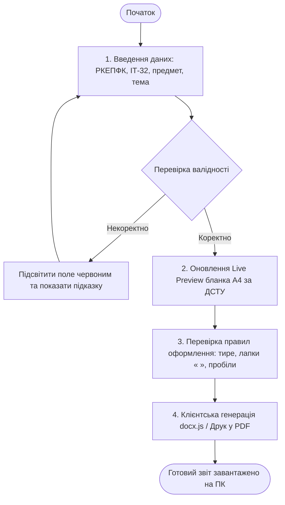

# ЖУРНАЛ ПРОМПТІВ ТА СПЕЦИФІКАЦІЯ РОЗРОБКИ STUDZVIT
## Інженерний процес взаємодії з ШІ: від ідеї до коду

> **Примітка:** Цей документ фіксує послідовність промптів, структуру вимог та архітектурні діаграми відповідно до методології поетапного проектування програмного забезпечення.

---

### ЕТАП 1. ФОРМУЛЮВАННЯ ГОЛОВНОЇ ІДЕЇ (IDEA PROMPT)

**Промпт, що задавався:**
```text
Дій як старший веб-інженер та методист коледжу. 
У мене є ідея: студенти спеціальності 121 «Інженерія програмного забезпечення» Рівненського кооперативного економіко-правового фахового коледжу (РКЕПФК) витрачають багато часу на однакове оформлення звітів до практичних та лабораторних робіт. 

Сформулюй чітку концепцію веб-сервісу «StudZvit», який:
1. Об'єднує титульний аркуш та розділи звіту в єдиний покроковий конструктор.
2. Забезпечує миттєвий попередній перегляд (Live Preview) макета А4 з точними відступами ДСТУ (30-10-20-20 мм).
3. Перевіряє текст на типографіку (тире замість дефісів, українські лапки « », абзац 1.25 см).
4. Експортує результат у повноцінний Microsoft Word (.docx) із закріпленими стилями коледжу.
```

---

### ЕТАП 2. ЗБІР ТА СТРУКТУРУВАННЯ ВИМОГ (REQUIREMENTS PROMPT)

**Промпт, що задавався:**
```text
На основі затвердженої концепції сформуй специфікацію вимог:
1. Організаційна структура: РКЕПФК, Відділення комп'ютерних технологій, Циклова комісія інженерії програмного забезпечення.
2. Структура навчального звіту:
   - Крок 1: Титульний аркуш (предмет, тема, номер роботи, варіант, студент гр. ІТ-32, викладач).
   - Крок 2: Мета та завдання роботи.
   - Крок 3: Хід виконання та блоки коду (C#, JavaScript, HTML).
   - Крок 4: Висновки та використані джерела.
3. Нефункціональні вимоги: 100% Client-Side обробка (без зовнішнього бекенду та бази даних, конфіденційність даних студента), адаптивність під телефони та ПК.
```

---

### ЕТАП 3. ПОБУДОВА АРХІТЕКТУРИ ТА СХЕМИ АЛГОРИТМУ (MERMAID PROMPT)

**Промпт, що задавався:**
```text
Побудуй схему алгоритму роботи веб-сервісу у форматі Mermaid.js для візуалізації в реальному часі та інтеграції в mermaid.live:
```



---

### ЕТАП 4. МОДУЛЬНА РЕАЛІЗАЦІЯ ІНТЕРФЕЙСУ ТА СКРИПТІВ (CODE GENERATION)

**Промпт, що задавався:**
```text
Створи модульний, чистий код веб-додатка без «спагетті-структури»:
1. index.html: семантична розмітка, єдиний конструктор звіту (включаючи титулку як перший крок), розділ перевірки тексту за ДСТУ, розділ промптів.
2. style.css: системні кольори, розміри аркуша А4 (210х297 мм, поля 30-10-20-20 мм), правила друку @media print.
3. script.js: розбиття на незалежні функціональні модулі:
   - Модуль навігації та вкладок.
   - Модуль управління станом звіту (State Management).
   - Модуль валідації полів та обробки подій input/change.
   - Модуль перевірки правил оформлення (ДСТУ-типографіка).
   - Модуль експорту Word (.docx) на базі docx.js.
```
