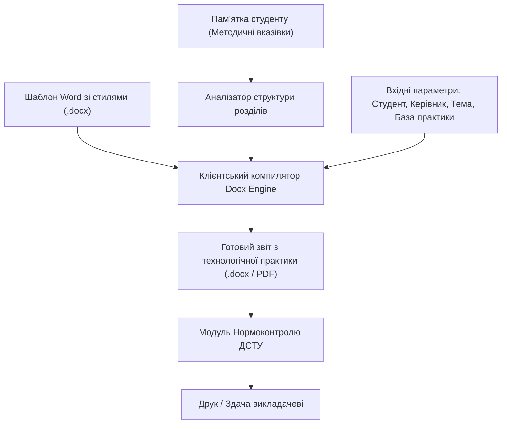

# StudZvit — Система автоматизованого формування звітів та документації коледжу

**StudZvit** — веб-сервіс інженерного проектування та автоматизованого формування звітної документації (зокрема **звітів з технологічної практики**, курсових та лабораторних робіт) за стандартами **ДСТУ 3008:2015** та методичними пам'ятками коледжу.

🔗 **Демонстраційна версія:** [https://m-messa-it.github.io/StudZvit/](https://m-messa-it.github.io/StudZvit/)  
📋 **Повна специфікація вимог (SRS):** [REQUIREMENTS_SPECIFICATION.md](./REQUIREMENTS_SPECIFICATION.md)

---

## 📌 Архітектурна концепція (Template-Driven Automation)

Замість заповнення абстрактних форм у системі реалізовано підхід на основі **фірмового шаблону коледжу (.docx) зі закріпленими стилями** та аналізатора структури обов'язкових розділів практики:

---

## 🏛 Відповідність структурі коледжу

Усі форми та генератори суворо адаптовані під організаційну структуру коледжу:
- **Відділення:** Відділення комп'ютерних технологій / Інженерії програмного забезпечення (без університетських «факультетів»).
- **Циклова комісія:** Циклова комісія інженерії програмного забезпечення / комп'ютерних дисциплін (без «кафедр»).
- **Спеціальності:** 121 «Інженерія програмного забезпечення», 123 «Комп'ютерна інженерія».

---

## 📊 Структура звіту з технологічної практики (за пам'яткою)

1. **Титульний аркуш** — Міністерство, Коледж, Відділення, Циклова комісія, база практики, погодження керівників.
2. **Індивідуальне завдання** — тема, терміни та календарний план проходження.
3. **Щоденник практики** — таблиця виконаних робіт по днях.
4. **Вступ** — мета, виробничі завдання та актуальність.
5. **Розділ 1: Загальна характеристика бази практики** — опис IT-підприємства.
6. **Розділ 2: Технологічна частина** — проектування, архітектура, код та тестування.
7. **Розділ 3: Охорона праці та БЖД** — ергономіка робочого місця оператора ЕОМ за ДСанПіН.
8. **Висновки** — підсумки виконання індивідуального плану.
9. **Список використаних джерел** — стандартизоване оформлення за ДСТУ 8302:2015.

---

## 🔍 Модуль Нормоконтролю

- **Типографіка:** автозаміна дефісів на довгі тире (`—`), перевірка апострофів (`'` / `’`), правильні друкарські лапки (`« »`).
- **Форматування:** ліквідація подвійних пробілів, контроль абзацного відступу 1.25 см.
- **Стандарт А4:** відступи сторінки: ліве 30 мм, праве 10 мм, верхнє 20 мм, нижнє 20 мм (ДСТУ).

---

## 🛠 Стек технологій
- **Frontend:** чистий HTML5, CSS3 (адаптивна верстка Flexbox/Grid, `@media print`), Vanilla JavaScript.
- **Office Automation:** `docx.js` (генерація Microsoft Word на клієнті), `FileSaver.js`.
- **Безпека:** 100% Client-Side обробка без передачі конфіденційних персональних даних на сторонні сервери.
