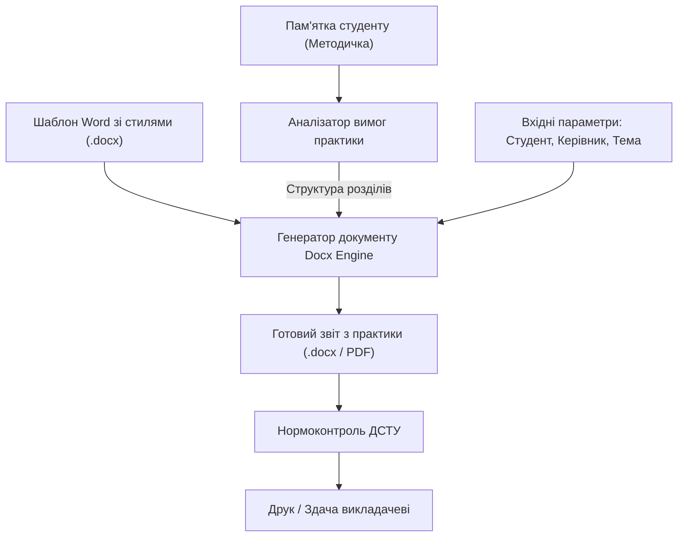
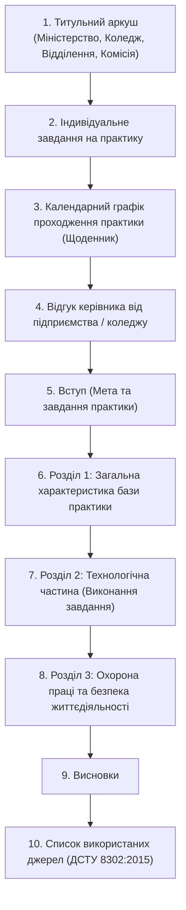
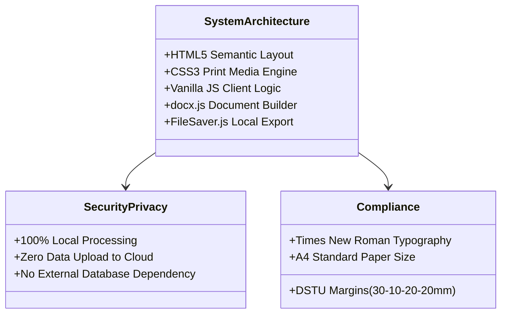

# ТЕХНІЧНЕ ЗАВДАННЯ ТА СПЕЦИФІКАЦІЯ ВИМОГ (SRS)
## Веб-сервіс автоматизованого формування навчальної звітної документації коледжу «StudZvit»

---

### 1. ВСТУП ТА ЗАГАЛЬНІ ВІДОМОСТІ

#### 1.1. Найменування розробки
Програмна система автоматизації підготовки звітів та студентської документації «StudZvit».

#### 1.2. Галузь застосування
Навчальний процес у закладах фахової передвищої освіти (коледжах) для студентів технічних спеціальностей (зокрема 121 «Інженерія програмного забезпечення», 123 «Комп'ютерна інженерія»).

#### 1.3. Призначення системи
Система призначена для прискорення підготовки звітів до практичних, лабораторних робіт та курсових проєктів шляхом:
1. Застосування стандартизованих шаблонів Word (.docx) із закріпленими стилями коледжу.
2. Автоматичної структуризації матеріалу на основі методичних вказівок.
3. Нормоконтролю відступів, типографіки та правил ДСТУ.

---

### 2. АНАЛІЗ ПРОБЛЕМИ ТА АРХІТЕКТУРНА КОНЦЕПЦІЯ

#### 2.1. Чому ручне заповнення форм неефективне
Традиційний підхід із ручним заповненням десятків полів на веб-сайтах вимагає повторного введення даних, які вже існують у методичних рекомендаціях. 

#### 2.2. Запропонований підхід (Template-Driven Automation)
Замість ручного введення система оперує:
- **Базовим файлом стилів (.docx template)**: містить фірмові стилі заголовків, списків, таблиць та шрифтові схеми (Times New Roman 14pt, 1.5 міжрядковий інтервал, абзацний відступ 1.25 см).
- **Матрицею вимог практики**: титульний аркуш, індивідуальне календарне завдання, журнал/щоденник практики, основна аналітична частина, розділ охорони праці та висновки.

---

### 3. СТРУКТУРА ДОКУМЕНТА ЗВІТУ З ТЕХНОЛОГІЧНОЇ ПРАКТИКИ

Відповідно до вимог коледжу, звіт обов'язково містить наступні складові частини у суворій послідовності:

---

### 4. ФУНКЦІОНАЛЬНІ ВИМОГИ

| Код вимоги | Назва вимоги | Опис функціоналу |
|---|---|---|
| **FR-01** | Адаптація термінології коледжу | Заміна понять «Факультет/Кафедра» на **«Відділення»** та **«Циклова комісія»**. |
| **FR-02** | Підтримка Word-шаблонів (.docx) | Формування звіту безпосередньо у форматі Microsoft Word зі збереженням призначених стилів коледжу. |
| **FR-03** | Генератор титулки за ДСТУ | Поля: ліве 30 мм, праве 10 мм, верхнє 20 мм, нижнє 20 мм. Точне вирівнювання блоків «Виконав» та «Прийняв». |
| **FR-04** | Модуль Нормоконтролю | Автоматична заміна дефісів на тире (—), корекція лапок на друкарські (« »), ліквідація подвійних пробілів, контроль абзаців 1.25 см. |
| **FR-05** | Модуль бібліографії | Формування списку джерел за стандартом ДСТУ 8302:2015 в алфавітному порядку. |
| **FR-06** | Автономна робота (Client-Side) | Генерація документів на стороні браузера клієнта без передачі персональних даних на сторонні сервери. |

---

### 5. НЕФУНКЦІОНАЛЬНІ ТА СИСТЕМНІ ВИМОГИ

1. **Швидкодія**: формування файлу обсягом 15–25 сторінок виконується менше ніж за 1.5 секунди.
2. **Кросплатформеність**: коректна робота у веб-браузерах Google Chrome, Mozilla Firefox, Microsoft Edge, Safari на ОС Windows, macOS, Android та iOS.
3. **Автономність**: сервіс функціонує навіть за відсутності постійного інтернет-з'єднання після початкового кешування (Service Worker / PWA).

