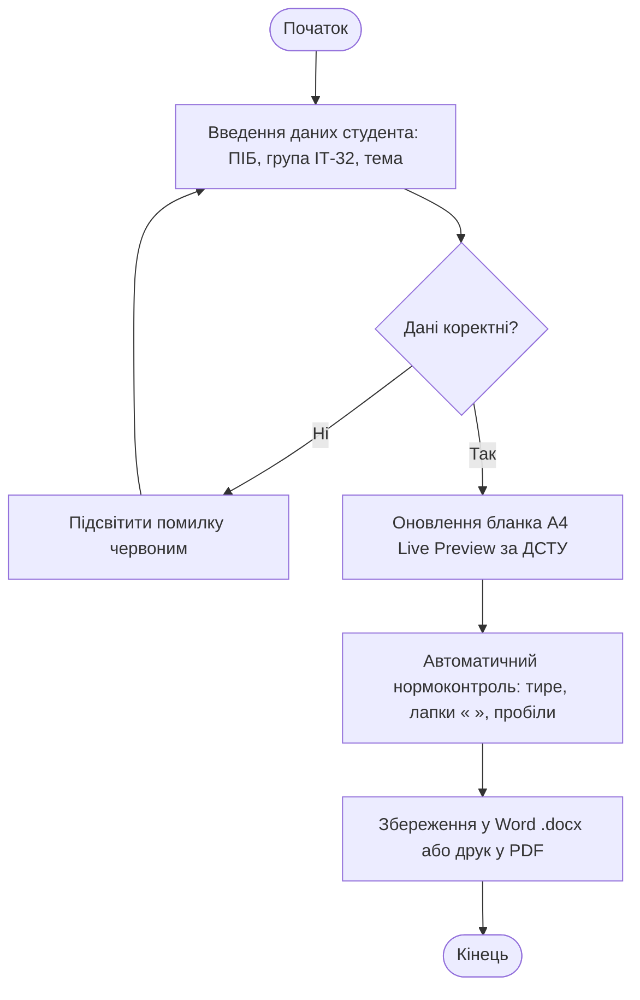

# ТЕХНІЧНЕ ЗАВДАННЯ ТА СПЕЦИФІКАЦІЯ ВИМОГ
## Веб-сервіс автоматизованого формування навчальної документації «StudZvit»

---

### 1. ЗАГАЛЬНІ ВІДОМОСТІ
- **Навчальний заклад:** Рівненський кооперативний економіко-правовий фаховий коледж (РКЕПФК)
- **Відділення:** Відділення комп'ютерних технологій
- **Циклова комісія:** Циклова комісія інженерії програмного забезпечення
- **Спеціальність:** 121 «Інженерія програмного забезпечення» (група ІТ-32)
- **Призначення:** автоматизація створення титульних аркушів, звітів до практичних та лабораторних робіт за стандартом ДСТУ 3008:2015.

---

### 2. СТРУКТУРА ТА СХЕМА АЛГОРИТМУ (DRAW.IO)

---

### 3. ФУНКЦІОНАЛЬНІ ВИМОГИ

| Код | Назва | Опис |
|---|---|---|
| **FR-01** | Введення реквізитів | Введення назви дисципліни, номера роботи, варіанта, теми, студента та викладача. |
| **FR-02** | Live Preview А4 | Миттєве відображення макета на екрані при введенні тексту (подія `input`). |
| **FR-03** | Нормоконтроль | Автоматичне виправлення типографічних помилок (дефіси на довгі тире, прямі лапки на ялинки « »). |
| **FR-04** | Експорт у Word | Формування офіційного файлу `.docx` зі збереженням шрифту Times New Roman 14pt, 1.5 інтервалу та полів ДСТУ. |
| **FR-05** | Безпека | Обробка даних виключно на пристрої користувача (Client-Side) без збереження у хмарі. |

---

### 4. ПАРАМЕТРИ ОФОРМЛЕННЯ ЗА ДСТУ 3008:2015
- **Формат паперу:** А4 (210 × 297 мм).
- **Поля аркуша:** ліве — 30 мм, праве — 10 мм, верхнє — 20 мм, нижнє — 20 мм.
- **Шрифт:** Times New Roman, 14 pt, міжрядковий інтервал 1.5 рядка.
- **Абзацний відступ:** 1.25 см (перший рядок параграфа).
- **Вирівнювання:** по ширині сторінки (Justify).
